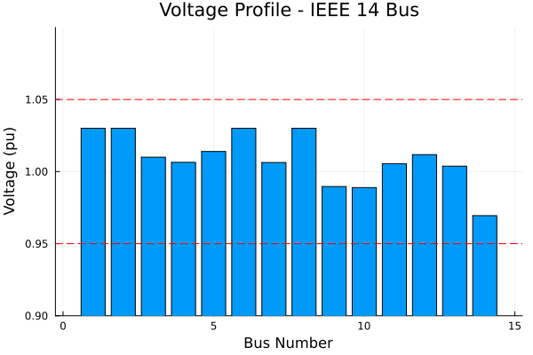
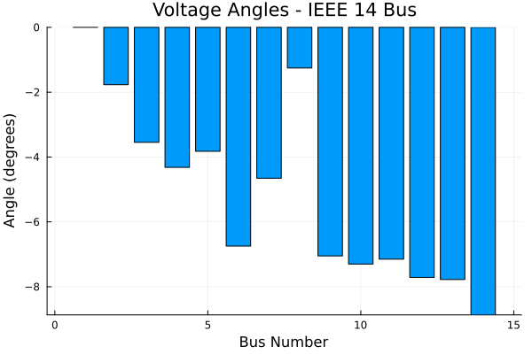
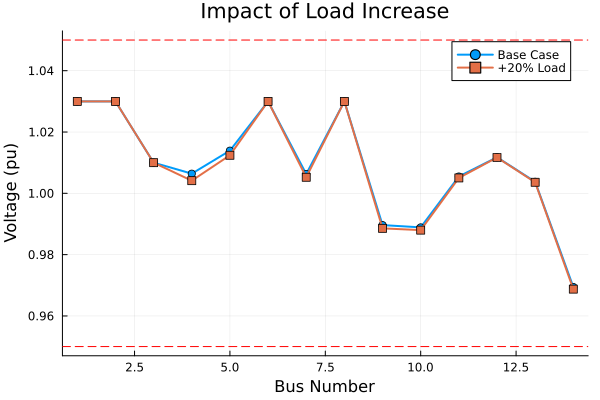

# Getting Started with Powerful.jl

Interactive walkthrough of the basic power flow workflow. See [Getting Started Guide](../guides/getting_started.md) for detailed explanations.

## Setup


```julia
using Powerful
using Powerful.PowerFlowData
using Plots
using DataFrames
```

## 1. Load System and Solve

Load IEEE 14-bus test case


```julia
case = PowerFlowData.parse_network(joinpath(pkgdir(Powerful), "cases", "ieee14.raw"))
sys = SystemModel(case)
```


    SystemModel{Vector}:
      Components:
        PV: 4 elements
        Owner: 2 elements
        Branch: 16 elements
        AreaInterchange: 2 elements
        Transformer2W: 4 elements
        Bus: 14 elements
        PQ: 11 elements
        Slack: 1 elements
        Zone: 2 elements


Create and solve problem


```julia
prob = ACPowerFlowProblem(sys)
sol = solve(prob, NewtonRaphson())
```


    PowerFlowSolution{Float64}:
      Converged: true
      Iterations: 4
      Residual: 3.25e-12
      Variables: 28


## 2. Convergence Check


```julia
println("Converged: ", sol.converged)
println("Iterations: ", sol.iterations)
println("Final residual: ", sol.residual_norm)
```

    Converged: true
    Iterations: 4
    Final residual: 3.2540081740251026e-12


## 3. System Summary


```julia
println("System composition:")
for (model, data) in pairs(sys.models)
    println("  $model: $(length(data)) elements")
end
```

    System composition:
      PV: 4 elements
      Owner: 2 elements
      Branch: 16 elements
      AreaInterchange: 2 elements
      Transformer2W: 4 elements
      Bus: 14 elements
      PQ: 11 elements
      Slack: 1 elements
      Zone: 2 elements


## 4. Voltage Profile

Extract voltages and angles


```julia
voltages = get_all_vars(sol, :Bus, :v)
angles = get_all_vars(sol, :Bus, :theta)
```


    14-element Vector{Float64}:
      0.0
     -0.030889488052363804
     -0.06192075737642622
     -0.0753779378041258
     -0.06674497569798812
     -0.1177320784486816
     -0.08122423044264039
     -0.021899363458570402
     -0.12303724344184239
     -0.1274403768419337
     -0.12478293439600781
     -0.13459737679704212
     -0.13574374968984587
     -0.1547931120641637


Plot voltage magnitudes


```julia
bar(1:length(voltages), voltages,
    xlabel="Bus Number",
    ylabel="Voltage (pu)",
    title="Voltage Profile - IEEE 14 Bus",
    legend=false,
    ylims=(0.9, 1.1))
hline!([0.95, 1.05], ls=:dash, color=:red, label="Limits")
```





## 5. Voltage Angles

Convert to degrees for readability


```julia
angles_deg = rad2deg.(angles)

bar(1:length(angles_deg), angles_deg,
    xlabel="Bus Number",
    ylabel="Angle (degrees)",
    title="Voltage Angles - IEEE 14 Bus",
    legend=false)
```





## 6. Results Table

Collect bus results


```julia
bus_data = collect_model_table(sol, :Bus)
df = DataFrame(bus_data)
```


```@raw html
<div><div style = "float: left;"><span>14×3 DataFrame</span></div><div style = "clear: both;"></div></div><div class = "data-frame" style = "overflow-x: scroll;"><table class = "data-frame" style = "margin-bottom: 6px;"><thead><tr class = "columnLabelRow"><th class = "stubheadLabel" style = "font-weight: bold; text-align: right;">Row</th><th style = "text-align: left;">I</th><th style = "text-align: left;">Theta (deg)</th><th style = "text-align: left;">V (pu)</th></tr><tr class = "columnLabelRow"><th class = "stubheadLabel" style = "font-weight: bold; text-align: right;"></th><th title = "String" style = "text-align: left;">String</th><th title = "Float64" style = "text-align: left;">Float64</th><th title = "Float64" style = "text-align: left;">Float64</th></tr></thead><tbody><tr class = "dataRow"><td class = "rowLabel" style = "font-weight: bold; text-align: right;">1</td><td style = "text-align: left;">1</td><td style = "text-align: right;">0.0</td><td style = "text-align: right;">1.03</td></tr><tr class = "dataRow"><td class = "rowLabel" style = "font-weight: bold; text-align: right;">2</td><td style = "text-align: left;">2</td><td style = "text-align: right;">-1.76984</td><td style = "text-align: right;">1.03</td></tr><tr class = "dataRow"><td class = "rowLabel" style = "font-weight: bold; text-align: right;">3</td><td style = "text-align: left;">3</td><td style = "text-align: right;">-3.5478</td><td style = "text-align: right;">1.01</td></tr><tr class = "dataRow"><td class = "rowLabel" style = "font-weight: bold; text-align: right;">4</td><td style = "text-align: left;">4</td><td style = "text-align: right;">-4.31884</td><td style = "text-align: right;">1.00642</td></tr><tr class = "dataRow"><td class = "rowLabel" style = "font-weight: bold; text-align: right;">5</td><td style = "text-align: left;">5</td><td style = "text-align: right;">-3.82421</td><td style = "text-align: right;">1.01393</td></tr><tr class = "dataRow"><td class = "rowLabel" style = "font-weight: bold; text-align: right;">6</td><td style = "text-align: left;">6</td><td style = "text-align: right;">-6.74555</td><td style = "text-align: right;">1.03</td></tr><tr class = "dataRow"><td class = "rowLabel" style = "font-weight: bold; text-align: right;">7</td><td style = "text-align: left;">7</td><td style = "text-align: right;">-4.65381</td><td style = "text-align: right;">1.0063</td></tr><tr class = "dataRow"><td class = "rowLabel" style = "font-weight: bold; text-align: right;">8</td><td style = "text-align: left;">8</td><td style = "text-align: right;">-1.25474</td><td style = "text-align: right;">1.03</td></tr><tr class = "dataRow"><td class = "rowLabel" style = "font-weight: bold; text-align: right;">9</td><td style = "text-align: left;">9</td><td style = "text-align: right;">-7.04951</td><td style = "text-align: right;">0.989641</td></tr><tr class = "dataRow"><td class = "rowLabel" style = "font-weight: bold; text-align: right;">10</td><td style = "text-align: left;">10</td><td style = "text-align: right;">-7.3018</td><td style = "text-align: right;">0.988895</td></tr><tr class = "dataRow"><td class = "rowLabel" style = "font-weight: bold; text-align: right;">11</td><td style = "text-align: left;">11</td><td style = "text-align: right;">-7.14954</td><td style = "text-align: right;">1.00549</td></tr><tr class = "dataRow"><td class = "rowLabel" style = "font-weight: bold; text-align: right;">12</td><td style = "text-align: left;">12</td><td style = "text-align: right;">-7.71186</td><td style = "text-align: right;">1.01176</td></tr><tr class = "dataRow"><td class = "rowLabel" style = "font-weight: bold; text-align: right;">13</td><td style = "text-align: left;">13</td><td style = "text-align: right;">-7.77754</td><td style = "text-align: right;">1.00377</td></tr><tr class = "dataRow"><td class = "rowLabel" style = "font-weight: bold; text-align: right;">14</td><td style = "text-align: left;">14</td><td style = "text-align: right;">-8.86899</td><td style = "text-align: right;">0.969449</td></tr></tbody></table></div>
```


## 7. Access Individual Variables

Bus 1 (slack bus)


```julia
v1 = get_var(sol, :Bus, :v, (1,))
θ1 = get_var(sol, :Bus, :theta, (1,))

println("Bus 1 voltage: $(round(v1, digits=4)) pu")
println("Bus 1 angle: $(round(rad2deg(θ1), digits=2))°")
```

    Bus 1 voltage: 1.03 pu
    Bus 1 angle: 0.0°


## 8. Modify and Re-solve

Modifying system parameters requires creating a new problem.

**Note:** Use loads at pure PQ buses (no generators) to see voltage changes. PV buses maintain constant voltage.

Increase load at Bus 4 (pure PQ bus) by 20%


```julia
load_idx = 3  # Load 3 is at Bus 4
bus_id = 4
original_load = sys.models.PQ.pl[load_idx]
sys.models.PQ.pl[load_idx] *= 1.2
sys.models.PQ.ql[load_idx] *= 1.2
```


    0.12


Create new problem with warm start (use previous solution)


```julia
prob_new = ACPowerFlowProblem(sys; initial_guess=sol.dae.y)
sol_new = solve(prob_new, NewtonRaphson())
```


    PowerFlowSolution{Float64}:
      Converged: true
      Iterations: 3
      Residual: 8.62e-9
      Variables: 28


Check voltage change at Bus 4


```julia
v_base = get_var(sol, :Bus, :v, (bus_id,))
v_new = get_var(sol_new, :Bus, :v, (bus_id,))

println("Original load: $(round(original_load, digits=3)) pu")
println("New load: $(round(sys.models.PQ.pl[load_idx], digits=3)) pu")
println("Converged: ", sol_new.converged)
println("Iterations: ", sol_new.iterations)
println("Bus $bus_id voltage: $(round(v_base, digits=6)) → $(round(v_new, digits=6)) pu")
println("Voltage change: $(round(v_new - v_base, digits=6)) pu ($(round((v_new-v_base)/v_base*100, digits=3))%)")
```

    Original load: 0.478 pu
    New load: 0.574 pu
    Converged: true
    Iterations: 3
    Bus 4 voltage: 1.006418 → 1.004125 pu
    Voltage change: -0.002293 pu (-0.228%)


## 9. Compare Results

Get new voltages


```julia
voltages_new = get_all_vars(sol_new, :Bus, :v)
```


    14-element Vector{Float64}:
     1.03
     1.03
     1.01
     1.0041254703350726
     1.012424358662767
     1.03
     1.0052416319571673
     1.03
     0.9885748434111276
     0.9880018868629206
     1.0050237555354686
     1.0116888731913811
     1.0036048744174901
     0.9687533649787688


Plot comparison


```julia
plot(1:length(voltages), voltages,
     label="Base Case", marker=:circle, lw=2)
plot!(1:length(voltages_new), voltages_new,
      label="+20% Load", marker=:square, lw=2)
xlabel!("Bus Number")
ylabel!("Voltage (pu)")
title!("Impact of Load Increase")
hline!([0.95, 1.05], ls=:dash, color=:red, label="")
```





## Next Steps

- **[Power Flow Analysis](../guides/powerflow.md)** - Formulations and algorithms
- **[Time-Domain Simulation](../guides/tds.md)** - Dynamic analysis
- **[Accessing Results](../guides/accessing_variables.md)** - Complete API reference

---

*This notebook was generated using [Literate.jl](https://github.com/fredrikekre/Literate.jl).*
