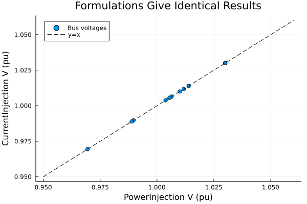
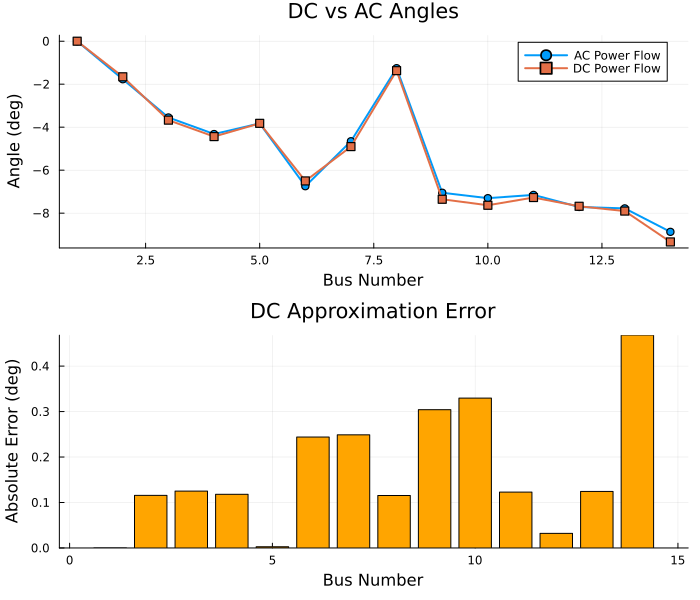
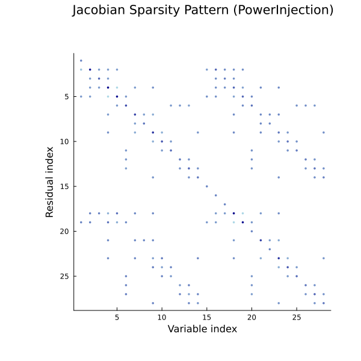

# Power Flow Formulations and Solvers

This notebook explores different formulations and solver algorithms for power flow analysis:

1. **Formulations**: PowerInjection, CurrentInjection, DCPowerFlow
2. **Algorithms**: NewtonRaphson, RobustNewton, FastDecoupledXB
3. **Linear Solvers**: KLU ordering options, GPU acceleration
4. **Jacobian Analysis**: Sparsity patterns and structure
5. **Convergence Behavior**: Performance comparison

See [Power Flow Guide](../docs/src/guides/powerflow.md) for detailed theory.

## Setup


```julia
using Powerful
using Powerful.PowerFlowData
using Plots
using DataFrames
using Powerful.SparseArrays
using Powerful.LinearAlgebra
using Printf
```

## Load Test System


```julia
# Load IEEE 14-bus system
case = PowerFlowData.parse_network(joinpath(pkgdir(Powerful), "cases", "ieee14.raw"))
sys = SystemModel(case)

println("Loaded IEEE 14-bus system:")
println("  Buses: ", length(sys.models.Bus))
println("  Branches: ", length(sys.models.Branch))
println("  PQ Loads: ", length(sys.models.PQ))
println("  PV Generators: ", length(sys.models.PV))
```

    Loaded IEEE 14-bus system:
      Buses: 14
      Branches: 16
      PQ Loads: 11
      PV Generators: 4


## Part 1: AC Power Flow Formulations

### PowerInjection vs CurrentInjection

Both formulations give identical physical results but differ in numerical behavior.

**PowerInjection (Polar)**:
- Variables: θ (angle), V (magnitude)
- Equations: P = V∑V(G·cos + B·sin), Q = V∑V(G·sin - B·cos)
- **Pros**: Standard formulation, slightly faster
- **Cons**: Division by V → numerical issues near voltage collapse

**CurrentInjection (Rectangular)**:
- Variables: Vᵣ (real), Vᵢ (imaginary)
- Equations: Iᵣ = G·Vᵣ - B·Vᵢ, Iᵢ = G·Vᵢ + B·Vᵣ
- **Pros**: Better conditioning near low voltage, no division by V
- **Cons**: Slightly more iterations for well-conditioned cases

### Solve with PowerInjection (Default)

PowerInjection formulation (polar coordinates)


```julia
prob_pi = ACPowerFlowProblem(sys, PowerInjection())
sol_pi = solve(prob_pi, NewtonRaphson())

println("PowerInjection Results:")
println("  Converged: ", sol_pi.converged)
println("  Iterations: ", sol_pi.iterations)
println("  Residual: ", sol_pi.residual_norm)
println("  Variables: $(length(sol_pi.dae.y)) (θ + V)")
```

    PowerInjection Results:
      Converged: true
      Iterations: 4
      Residual: 3.2540081740251026e-12
      Variables: 28 (θ + V)


### Solve with CurrentInjection

CurrentInjection formulation (rectangular coordinates)


```julia
prob_ci = ACPowerFlowProblem(sys, CurrentInjection())
sol_ci = solve(prob_ci, NewtonRaphson())

println("CurrentInjection Results:")
println("  Converged: ", sol_ci.converged)
println("  Iterations: ", sol_ci.iterations)
println("  Residual: ", sol_ci.residual_norm)
println("  Variables: $(length(sol_ci.dae.y)) (Vᵣ + Vᵢ)")
```

    CurrentInjection Results:
      Converged: true
      Iterations: 4
      Residual: 6.550315845288424e-14
      Variables: 28 (Vᵣ + Vᵢ)


### Verify Both Give Identical Physical Results

Extract voltage magnitudes from PowerInjection (has v directly)


```julia
v_pi = get_all_vars(sol_pi, :Bus, :v)
```


    14-element Vector{Float64}:
     1.03
     1.03
     1.01
     1.0064182134199788
     1.0139300447020223
     1.03
     1.0062975792003375
     1.03
     0.9896406371243133
     0.988895098466245
     1.0054902612877386
     1.0117637572015261
     1.0037732703003135
     0.9694486258430118


CurrentInjection uses rectangular coordinates (Vᵣ, Vᵢ)
Need to compute magnitude: V = √(Vᵣ² + Vᵢ²)


```julia
v_r_ci = get_all_vars(sol_ci, :Bus, :v_r)
v_i_ci = get_all_vars(sol_ci, :Bus, :v_i)
v_ci = sqrt.(v_r_ci.^2 .+ v_i_ci.^2)
```


    14-element Vector{Float64}:
     1.03
     1.03
     1.0100000000000005
     1.0064182134198794
     1.013930044701932
     1.0300000000000318
     1.0062975792001334
     1.0300000000000011
     0.9896406371239532
     0.9888950984659433
     1.0054902612875964
     1.0117637572014473
     1.0037732703001188
     0.9694486258421399


Compare


```julia
max_diff = maximum(abs.(v_pi .- v_ci))
println("Maximum voltage difference: ", max_diff)
println("Formulations agree: ", max_diff < 1e-8)
```

    Maximum voltage difference: 8.719691635405979e-13
    Formulations agree: true


Plot comparison


```julia
scatter(v_pi, v_ci,
    xlabel="PowerInjection V (pu)",
    ylabel="CurrentInjection V (pu)",
    title="Formulations Give Identical Results",
    label="Bus voltages",
    legend=:topleft)
plot!([0.95, 1.06], [0.95, 1.06], ls=:dash, color=:black, label="y=x")
```


### When to Use Each Formulation

**PowerInjection**:
- Well-conditioned systems
- Normal operation (voltages 0.95-1.05 pu)
- Slightly faster (~3-5% less time)

**CurrentInjection**:
- Stressed systems (heavy loading)
- Poor initial guesses
- Near voltage collapse
- When PowerInjection fails to converge

**Pro tip**: Try PowerInjection first; fall back to CurrentInjection if convergence fails.

## Part 2: DC Power Flow

### Linear Approximation for Fast Analysis

DC power flow makes strong approximations:
- All voltage magnitudes = 1.0 pu (ignored)
- Small angle differences: sin(θᵢ - θⱼ) ≈ θᵢ - θⱼ
- Negligible resistance: r << x
- Reactive power ignored completely

**Result**: Linear system → converges in 1-2 iterations!

**Use cases**:
- Fast contingency screening (N-1 analysis)
- Initial guess for AC power flow
- Large-scale transmission planning
- Security-constrained unit commitment

DC Power Flow


```julia
prob_dc = ACPowerFlowProblem(sys, DCPowerFlow())
ws_dc = setup_powerflow_newton(prob_dc; use_sparse=true)

println("DC Problem dimensions:")
println("  Variables: $(length(ws_dc.iter_dae.y)) (angles only, no voltages)")
println("  Residuals: $(length(ws_dc.iter_dae.g)) (P equations only, no Q)")
```

    DC Problem dimensions:
      Variables: 14 (angles only, no voltages)
      Residuals: 14 (P equations only, no Q)


Solve


```julia
y0_dc = copy(ws_dc.iter_dae.y)
sol_dc = solve_powerflow_newton!(ws_dc, y0_dc; abstol=1e-10, maxiters=50)

println("\nDC Results:")
println("  Converged: ", sol_dc.converged)
println("  Iterations: ", sol_dc.iterations, " (linear problem!)")
println("  Residual: ", sol_dc.residual_norm)
```

    
    DC Results:
      Converged: true
      Iterations: 2 (linear problem!)
      Residual: 1.0547118733938987e-15


### DC vs AC Angle Comparison

Extract angles from DC and AC solutions using get_all_vars


```julia
θ_dc = get_all_vars(sol_dc, :Bus, :theta)
θ_ac = get_all_vars(sol_pi, :Bus, :theta)
```


    14-element Vector{Float64}:
      0.0
     -0.030889488052363804
     -0.06192075737642622
     -0.0753779378041258
     -0.06674497569798812
     -0.1177320784486816
     -0.08122423044264039
     -0.021899363458570402
     -0.12303724344184239
     -0.1274403768419337
     -0.12478293439600781
     -0.13459737679704212
     -0.13574374968984587
     -0.1547931120641637


Convert to degrees


```julia
θ_dc_deg = rad2deg.(θ_dc)
θ_ac_deg = rad2deg.(θ_ac)
```


    14-element Vector{Float64}:
      0.0
     -1.7698372967202272
     -3.5477980619227827
     -4.3188377045760244
     -3.8242054111979655
     -6.7455512084125715
     -4.653805598561313
     -1.2547411001991018
     -7.049514772141236
     -7.301795732599556
     -7.149535496149079
     -7.711861624002588
     -7.777543952508446
     -8.868992018972168


Calculate errors


```julia
abs_error = abs.(θ_dc_deg .- θ_ac_deg)
rel_error = 100 .* abs_error ./ (abs.(θ_ac_deg) .+ 1e-10)  # Avoid division by zero
```


    14-element Vector{Float64}:
     0.0
     6.530917377380865
     3.5250553204241246
     2.7323761486634157
     0.06789209515406618
     3.6159289124118006
     5.344931619836614
     9.195457044722108
     4.313920246013772
     4.513917014274546
     1.7175339053012753
     0.41564830998747027
     1.5975614418627473
     5.276441993769136


Plot comparison


```julia
bus_numbers = 1:length(θ_dc_deg)

p1 = plot(bus_numbers, θ_ac_deg,
    label="AC Power Flow", marker=:circle, lw=2,
    xlabel="Bus Number", ylabel="Angle (deg)",
    title="DC vs AC Angles")
plot!(p1, bus_numbers, θ_dc_deg,
    label="DC Power Flow", marker=:square, lw=2)

p2 = bar(bus_numbers, abs_error,
    xlabel="Bus Number", ylabel="Absolute Error (deg)",
    title="DC Approximation Error",
    legend=false, color=:orange)

plot(p1, p2, layout=(2,1), size=(700, 600))
```


Error statistics


```julia
println("DC Approximation Error Statistics:")
println("  Max absolute error: ", @sprintf("%.4f", maximum(abs_error)), " degrees")
println("  Mean absolute error: ", @sprintf("%.4f", sum(abs_error)/length(abs_error)), " degrees")
println("  Max relative error: ", @sprintf("%.2f", maximum(rel_error[2:end])), "% (excluding slack)")
println("\nDC gives good angle approximation (5-15% typical error)")
println("But ignores voltage magnitudes and reactive power completely!")
```

    DC Approximation Error Statistics:
      Max absolute error: 0.4680 degrees
      Mean absolute error: 0.1679 degrees
      Max relative error: 9.20% (excluding slack)
    
    DC gives good angle approximation (5-15% typical error)
    But ignores voltage magnitudes and reactive power completely!


## Part 3: Algorithm Comparison

### Newton-Raphson vs RobustNewton vs FastDecoupled

Powerful.jl supports multiple solution algorithms:

1. **NewtonRaphson** (default)
   - Native implementation with KLU sparse solver
   - Full Jacobian, quadratic convergence
   - Best for well-conditioned systems

2. **RobustNewton**
   - NonlinearSolve.jl backend
   - Automatic trust region / line search
   - Better for difficult cases (~20-30% slower)

3. **FastDecoupledXB**
   - Decouples P-θ and Q-V equations
   - Constant matrices (factor once, reuse)
   - 2-3x faster for large transmission systems

### NewtonRaphson (Default)


```julia
prob = ACPowerFlowProblem(sys, PowerInjection())
sol_nr = solve(prob, NewtonRaphson())

println("NewtonRaphson:")
println("  Converged: ", sol_nr.converged)
println("  Iterations: ", sol_nr.iterations)
println("  Residual: ", sol_nr.residual_norm)
```

    NewtonRaphson:
      Converged: true
      Iterations: 4
      Residual: 3.2540081740251026e-12


### RobustNewton (NonlinearSolve.jl Backend)


```julia
sol_robust = solve(prob, RobustNewton())

println("RobustNewton:")
println("  Converged: ", sol_robust.converged)
println("  Iterations: ", sol_robust.iterations)
println("  Residual: ", sol_robust.residual_norm)
println("\nNote: May take more iterations but more robust for difficult cases")
```

    RobustNewton:
      Converged: true
      Iterations: 3
      Residual: 3.2548963524448027e-12
    
    Note: May take more iterations but more robust for difficult cases


### FastDecoupledXB


```julia
sol_fd = solve(prob, FastDecoupledXB())

println("FastDecoupledXB:")
println("  Converged: ", sol_fd.converged)
println("  Iterations: ", sol_fd.iterations)
println("  Residual: ", sol_fd.residual_norm)
println("\nNote: More iterations but each iteration is faster (constant matrices)")
```

    FastDecoupledXB:
      Converged: true
      Iterations: 22
      Residual: 8.346407393555744e-7
    
    Note: More iterations but each iteration is faster (constant matrices)


### Algorithm Comparison Summary

Create comparison table


```julia
df_alg = DataFrame(
    Algorithm = ["NewtonRaphson", "RobustNewton", "FastDecoupledXB"],
    Iterations = [sol_nr.iterations, sol_robust.iterations, sol_fd.iterations],
    Converged = [sol_nr.converged, sol_robust.converged, sol_fd.converged],
    Residual = [@sprintf("%.2e", sol_nr.residual_norm),
                @sprintf("%.2e", sol_robust.residual_norm),
                @sprintf("%.2e", sol_fd.residual_norm)]
)

println("\nAlgorithm Comparison:")
println(df_alg)
println("\nRecommendations:")
println("  • NewtonRaphson: Default choice (fast, reliable)")
println("  • RobustNewton: When NewtonRaphson fails or poor initial guess")
println("  • FastDecoupledXB: Large systems (>1000 buses) for speed")
```

    
    Algorithm Comparison:
    3×4 DataFrame
     Row │ Algorithm        Iterations  Converged  Residual
         │ String           Int64       Bool       String
    ─────┼──────────────────────────────────────────────────
       1 │ NewtonRaphson             4       true  3.25e-12
       2 │ RobustNewton              3       true  3.25e-12
       3 │ FastDecoupledXB          22       true  8.35e-07
    
    Recommendations:
      • NewtonRaphson: Default choice (fast, reliable)
      • RobustNewton: When NewtonRaphson fails or poor initial guess
      • FastDecoupledXB: Large systems (>1000 buses) for speed


## Part 4: Linear Solver Options

### KLU Sparse Solver with Different Orderings

The Newton method solves J·Δy = -g at each iteration.
KLU is a sparse direct solver optimized for circuit simulation.

**Fill-reducing orderings**:
- **AMD** (Approximate Minimum Degree) - default, best for most cases
- **COLAMD** (Column AMD) - alternative for some sparsity patterns
- **natural** - no reordering (fastest factorization, but more fill-in)

Ordering affects factorization speed and memory usage for large systems.

Compare different KLU orderings


```julia
sol_amd = solve(prob, NewtonRaphson(ordering=:AMD))
sol_colamd = solve(prob, NewtonRaphson(ordering=:COLAMD))
sol_natural = solve(prob, NewtonRaphson(ordering=:natural))

println("KLU Ordering Comparison:")
println("  AMD:     ", sol_amd.iterations, " iterations")
println("  COLAMD:  ", sol_colamd.iterations, " iterations")
println("  natural: ", sol_natural.iterations, " iterations")
println("\nNote: All converge to same solution, ordering affects factorization efficiency")
```

    KLU Ordering Comparison:
      AMD:     4 iterations
      COLAMD:  4 iterations
      natural: 4 iterations
    
    Note: All converge to same solution, ordering affects factorization efficiency


### GPU Acceleration with CUDSS

For large systems (>10k buses), GPU factorization can be faster:

```julia
using CUDA, CUDSS

# GPU-accelerated solver
sol_gpu = solve(prob, NewtonRaphson(linear_solver=CUDSSSolver()))
```

**Requirements**:
- NVIDIA GPU with CUDA support
- CUDSS.jl package installed

**Performance**:
- GPU overhead significant for small systems
- Pays off for >10k buses
- Hybrid mode: CPU Jacobian, GPU factorization

## Part 5: Jacobian Analysis

### Sparsity Pattern Visualization

The Jacobian J = ∂g/∂y is sparse due to network structure.
Only connected buses have non-zero entries.

Sparsity pattern reveals:
- Network topology
- Computational efficiency
- Memory requirements

Get Jacobian sparsity from workspace


```julia
ws = setup_powerflow_newton(prob; use_sparse=true)
```


    NewtonWorkspace:
      Variables: 28
      Jacobian: 28×28 (sparse)
      Backend: CPU
      Formulation: PowerInjection


Evaluate residuals


```julia
ws.adcache(ws.iter_dae.g, ws.iter_dae.y)
```

Compute Jacobian using DifferentiationInterface


```julia
using Powerful.DifferentiationInterface
g_buf = similar(ws.iter_dae.g)  # Output buffer for jacobian! call
DifferentiationInterface.jacobian!(
    ws.adcache, g_buf, ws.J, ws.jac_prep, ws.jac_backend, ws.iter_dae.y
)

J_sparse = ws.J
n = size(J_sparse, 1)
```


    28


Create spy plot with better layout


```julia
spy(J_sparse,
    title="Jacobian Sparsity Pattern (PowerInjection)\n",
    xlabel="Variable index",
    ylabel="Residual index",
    legend=false,
    color=:blues,
    markersize=2,
    size=(600, 600),
    top_margin=8Plots.mm,
    bottom_margin=8Plots.mm,
    left_margin=8Plots.mm)
```





Add annotations inside the plot area


```julia
annotate!(n/4, n*0.95, text("θ vars", 10, :center))
annotate!(3n/4, n*0.95, text("V vars", 10, :center))
annotate!(n*0.05, n/4, text("P eqs", 10, :left, rotation=90))
annotate!(n*0.05, 3n/4, text("Q eqs", 10, :left, rotation=90))
```


Sparsity statistics


```julia
n_nonzero = nnz(J_sparse)
n_total = n * n
sparsity = 100 * (1 - n_nonzero / n_total)

println("Jacobian Statistics:")
println("  Size: $(n) × $(n)")
println("  Non-zeros: $(n_nonzero) / $(n_total)")
println("  Sparsity: ", @sprintf("%.2f", sparsity), "%")
println("  Avg non-zeros per row: ", @sprintf("%.1f", n_nonzero/n))
println("\nSparse methods essential for large systems!")
```

    Jacobian Statistics:
      Size: 28 × 28
      Non-zeros: 216 / 784
      Sparsity: 72.45%
      Avg non-zeros per row: 7.7
    
    Sparse methods essential for large systems!


### Compare PowerInjection vs CurrentInjection Jacobian

CurrentInjection Jacobian


```julia
ws_ci = setup_powerflow_newton(prob_ci; use_sparse=true)
ws_ci.adcache(ws_ci.iter_dae.g, ws_ci.iter_dae.y)
g_buf_ci = similar(ws_ci.iter_dae.g)
DifferentiationInterface.jacobian!(
    ws_ci.adcache, g_buf_ci, ws_ci.J, ws_ci.jac_prep, ws_ci.jac_backend, ws_ci.iter_dae.y
)
J_ci = ws_ci.J
```


    28×28 SparseArrays.SparseMatrixCSC{Float64, Int64} with 216 stored entries:
    ⎡⢻⣶⡃⡀⡀⠀⠀⢻⣶⡃⡀⡀⠀⠀⎤
    ⎢⠉⠨⠛⣤⠄⠒⠂⠉⠨⠛⣤⠄⠒⠂⎥
    ⎢⠀⠈⢠⠁⠻⢆⡈⠀⠈⢠⠁⠻⢆⡈⎥
    ⎢⣤⣀⡌⠀⠂⠈⠛⣤⣀⡌⠀⠂⠈⠛⎥
    ⎢⠼⠻⣦⠂⠂⣀⡀⠼⠻⣦⠂⠂⣀⡀⎥
    ⎢⠀⠨⠀⠟⣥⡀⠠⠀⠨⠀⠟⣥⡀⠠⎥
    ⎣⠀⠀⠸⠀⡈⠱⣦⠀⠀⠸⠀⡈⠱⣦⎦


Plot both with better layout


```julia
p1 = spy(J_sparse,
    title="PowerInjection (Polar)",
    xlabel="Variable", ylabel="Residual",
    legend=false, color=:blues, markersize=2,
    left_margin=5Plots.mm, bottom_margin=5Plots.mm)

p2 = spy(J_ci,
    title="CurrentInjection (Rectangular)",
    xlabel="Variable", ylabel="Residual",
    legend=false, color=:orange, markersize=2,
    left_margin=5Plots.mm, bottom_margin=5Plots.mm)

plot(p1, p2, layout=(1,2), size=(1000, 450))
```





## Part 6: Convergence Behavior

### Newton Convergence Curve

Newton-Raphson exhibits quadratic convergence near the solution:
- Residual norm decreases by ~square each iteration
- Typical convergence: 3-5 iterations for well-conditioned systems
Track residual norm at each iteration with a helper function.


```julia
function solve_with_tracking(prob, alg)
    residuals = Float64[]
    # Setup workspace
    ws = setup_powerflow_newton(prob; use_sparse=true)
    y = copy(ws.iter_dae.y)
    g_buf = similar(ws.iter_dae.g)
    # Manual Newton iterations with tracking
    for iter in 1:20
        ws.adcache(ws.iter_dae.g, y)
        res_norm = norm(ws.iter_dae.g, Inf)
        push!(residuals, res_norm)
        if res_norm < 1e-8
            break
        end
        # Compute Jacobian
        DifferentiationInterface.jacobian!(
            ws.adcache, g_buf, ws.J, ws.jac_prep, ws.jac_backend, y
        )
        # Solve and update
        Δy = -(ws.J \ ws.iter_dae.g)
        y .+= Δy
    end
    return residuals
end
```


    solve_with_tracking (generic function with 1 method)


Track convergence for PowerInjection


```julia
residuals_pi = solve_with_tracking(prob_pi, NewtonRaphson())
```


    4-element Vector{Float64}:
     0.19067475726175495
     0.00308124645899549
     3.1932815930946212e-6
     3.2548963524448027e-12


Plot convergence


```julia
plot(0:(length(residuals_pi)-1), residuals_pi,
    yscale=:log10,
    xlabel="Iteration",
    ylabel="Residual Norm (||g||∞)",
    title="Newton-Raphson Convergence",
    marker=:circle,
    lw=2,
    label="PowerInjection",
    legend=:topright)

hline!([1e-8], ls=:dash, color=:red, label="Tolerance (1e-8)")
```


Quadratic convergence: residual decreases by ~square each iteration. Final iterations show linear convergence (finite precision).

### Compare Convergence: PowerInjection vs CurrentInjection

Track both formulations


```julia
residuals_ci = solve_with_tracking(prob_ci, NewtonRaphson())
```


    4-element Vector{Float64}:
     0.18877702171081473
     0.001970074834255209
     5.262382423154577e-7
     6.550315845288424e-14


Plot comparison


```julia
plot(0:(length(residuals_pi)-1), residuals_pi,
    yscale=:log10,
    xlabel="Iteration",
    ylabel="Residual Norm (||g||∞)",
    title="Convergence Comparison",
    marker=:circle,
    lw=2,
    label="PowerInjection (Polar)")

plot!(0:(length(residuals_ci)-1), residuals_ci,
    marker=:square,
    lw=2,
    label="CurrentInjection (Rectangular)")

hline!([1e-8], ls=:dash, color=:red, label="Tolerance")
```





For well-conditioned IEEE 14-bus:

- PowerInjection: 4 iterations
- CurrentInjection: 4 iterations
- Both converge similarly for this well-conditioned case
- Difference emerges for stressed/poorly-conditioned systems

## Summary

### Formulation Guidelines

| Formulation | Use When | Variables | Speed |
|-------------|----------|-----------|-------|
| **PowerInjection** | Well-conditioned systems | θ, V (polar) | Fastest |
| **CurrentInjection** | Stressed systems, near collapse | Vᵣ, Vᵢ (rectangular) | Similar |
| **DCPowerFlow** | Fast screening, initial guess | θ only | 10-100x faster |

### Algorithm Guidelines

| Algorithm | Use When | Iterations | Per-Iteration Cost |
|-----------|----------|------------|-----------------|
| **NewtonRaphson** | Default choice | 3-5 | Medium |
| **RobustNewton** | Convergence issues | 5-10 | Medium-High |
| **FastDecoupledXB** | Large systems (>1k buses) | 10-30 | Low (constant matrices) |

### Linear Solver Guidelines

| Solver | Best For | Notes |
|--------|----------|-------|
| **KLU (AMD)** | Most cases | Default, excellent performance |
| **KLU (COLAMD)** | Alternative ordering | Try if AMD is slow |
| **CUDSS (GPU)** | Very large systems (>10k) | Requires NVIDIA GPU |

### Best Practices

1. **Start with defaults**: `solve(prob, NewtonRaphson())`
2. **If convergence fails**: Try `RobustNewton()` or `CurrentInjection()`
3. **For speed**: Use `FastDecoupledXB()` for large transmission networks
4. **For screening**: Use `DCPowerFlow()` for contingency analysis
5. **For large systems**: Consider AMD reordering or GPU acceleration

### Next Steps

- **[Time-Domain Simulation](03_tds_basics.ipynb)** - Dynamic analysis with differential equations
- **[Contingency Analysis](05_contingency_analysis.ipynb)** - N-1 screening and reliability
- **[Power Flow Guide](../docs/src/guides/powerflow.md)** - Complete theoretical background

---

*This notebook was generated using [Literate.jl](https://github.com/fredrikekre/Literate.jl).*
